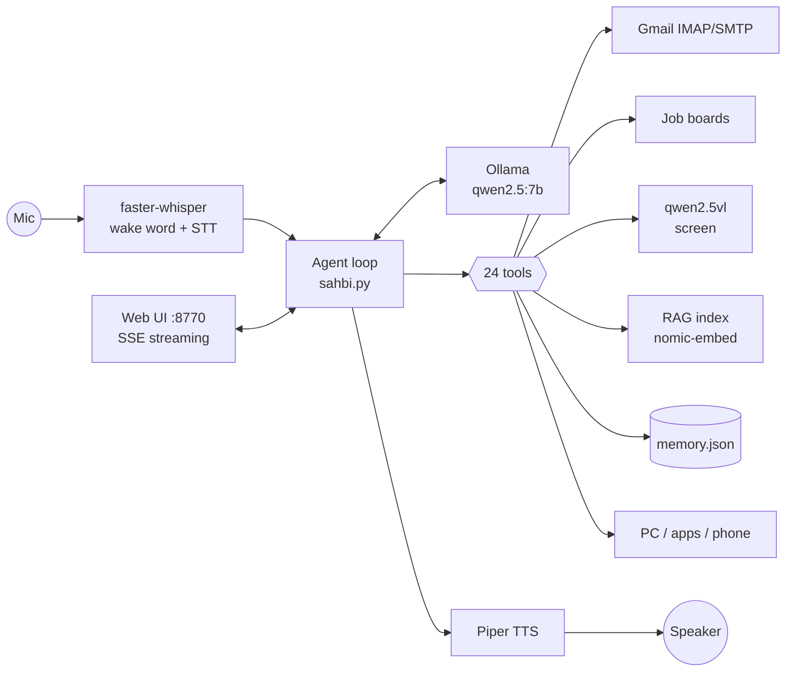

# Sahbi — a local voice AI assistant

> *"Salam Sahbi"* — Moroccan for *"Hi, my buddy"*.

Sahbi is a personal voice assistant that runs **100% on a Windows laptop** (tested on an RTX 3060, 6 GB).
Say the wake word in Darija, French or English and it answers out loud in English, controls the PC, reads and sends
Gmail, hunts for jobs, looks at the screen, remembers things and answers questions from your own documents.
No cloud LLM, no API keys, no per-message cost.

## Features

| | What it does | How |
|---|---|---|
| 🎙️ Wake word | "Salam Sahbi" in any accent, Arabic or Latin script | faster-whisper `base` on CPU + fuzzy matching, `small` model for commands |
| 🧠 Brain | Tool-calling agent with streaming replies | Ollama + `qwen2.5:7b`, 24 tools, live data injected to prevent hallucinated numbers |
| 🗣️ Voice | Natural neural voice, mic muted while speaking | Piper TTS (`en_US-lessac-medium`) |
| 📥 Gmail | Check inbox, read, reply, send with attachments — 10 s cancel window (voice "cancel", button or Esc) | IMAP/SMTP + Google App Password stored with Windows DPAPI |
| 🧭 Job hunter | Searches ReKrute + Emploi.ma, scores fit vs your skills, finds contact emails, sends CV, logs applications | requests + parsing, CSV log |
| 👁️ Screen | "What's this error on my screen?" | Screenshot → `qwen2.5vl:3b` vision model |
| 📚 Your documents | Ask questions about your courses, notes, projects (PDF, Word, PowerPoint, notebooks) | RAG: `nomic-embed-text` embeddings + cosine search, incremental index |
| 🧠 Long-term memory | "Remember that…" / "forget…" — facts kept forever | JSON memory injected into every prompt |
| 🌅 Morning brief | Spoken at the first start of the day: weather, markets, unread emails, follow-ups | |
| 📱 Phone | Reminders and files pushed to the phone | optional Beam bridge |
| 🎮 Auto game mode | A game starts → Sahbi shuts down and frees the GPU; game closes → back on | psutil watcher (Steam, Epic, Riot, …) |
| 🌍 Darija | Understands Moroccan Darija via a glossary injected per message | |
| 🫧 Knowledge bubble map | DexScreener-style linked bubbles: topics → documents → sections. Drag bubbles, click to see connections, double-click to enter, breadcrumb to go back | k-means + nearest-neighbour links on embeddings, force-directed canvas physics |
| 🎨 6 themes | Sahara Gold, Neon Tokyo, Aurora, Frost (light), Matrix, Atlas Sunset — press T to cycle | CSS variables, themed orb and map |

## Architecture



## Files

```
sahbi.py         server, agent loop, wake word, morning brief, background indexing
tools.py         the 24 tools the model can call
mailer.py        Gmail send/read, DPAPI-encrypted App Password
jobs.py          job board search, fit scoring, application log
rag.py           document indexing + semantic search (also a CLI)
vision.py        screenshot -> vision model
memory.py        long-term memory
voice.py         Piper TTS with Windows-voice fallback
gamewatch.py     auto game mode
config.py        settings; your values go in config.json (not committed)
web/index.html   the UI (no framework, no build step)
sahbi-toggle.ps1 manual on/off (frees the GPU)
test_voice.py    feed WAV files to the listener without a microphone
```

## Setup (Windows)

1. Install [Ollama](https://ollama.com) and Python 3.11+.
2. Run `setup.ps1` (creates `.venv`, installs requirements, pulls the models, downloads the voice).
3. Edit `config.json` (created from `config.example.json`): your name, folders, CV paths and apps.
4. Optional Gmail: run `Setup Sahbi email.bat` and paste a Google App Password (needs 2-Step Verification).
5. Start: `.venv\Scripts\pythonw.exe sahbi.py --open`. Put shortcuts to `sahbi.py` and `gamewatch.py` in the
   Startup folder to run at sign-in.

## Safety choices

- Emails only go to addresses the user gave, after a visible 10-second countdown that can be cancelled by voice.
- Text from emails, web pages, job offers and documents is labelled as data; the model is told never to follow it.
- Private folders (configurable) are refused by every file, phone and email tool.
- The Gmail App Password is encrypted with Windows DPAPI and never stored in the repo.

## Stack

Python · Flask (SSE) · Ollama · Qwen2.5 / Qwen2.5-VL · nomic-embed-text · faster-whisper · Piper · NumPy ·
sounddevice · psutil · vanilla JS + Canvas

---
Built by **Yassine Nabil** — AI & Data Engineering.
